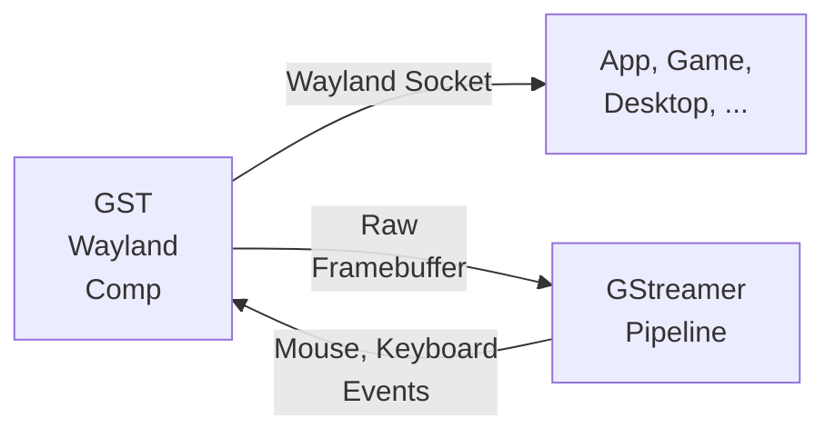

# gst-wayland-display

A micro Wayland compositor that can be used as a Gstreamer plugin. Based
on [smithay](https://github.com/Smithay/smithay)



## Install

see [cargo-c](https://github.com/lu-zero/cargo-c)

```bash
git clone https://github.com/games-on-whales/gst-wayland-display.git
cd gst-wayland-display
# Install cargo-c if you don't have it already
cargo install cargo-c
# Build and install the plugin, by default under 
cargo cinstall --prefix=/usr/local
```

## GStreamer plugin

By default it'll install the plugin in `/usr/local/lib/gstreamer-1.0/libgstwaylanddisplaysrc.so`.

You can check if the plugin is picked up by calling:

```bash
GST_PLUGIN_PATH=/usr/local/lib/gstreamer-1.0 gst-inspect-1.0 waylanddisplaysrc
```

Example pipeline:

```bash
GST_PLUGIN_PATH=/usr/local/lib/gstreamer-1.0 gst-launch-1.0 waylanddisplaysrc ! 'video/x-raw,width=1280,height=720,format=RGBx,framerate=60/1' !  autovideosink
```

If this starts you should have a wayland socket under `$XDG_RUNTIME_DIR`

```
ls $XDG_RUNTIME_DIR 
 wayland-1
 wayland-1.lock
```

You should then be able to start any wayland process and use that socket

```bash 
WAYLAND_DISPLAY=wayland-1 weston-simple-egl
```

## Zero copy pipeline support

This plugin supports outputting **DMA buffers** in order to achieve a proper **zero-copy pipeline**.  
It'll negotiate the proper caps with downstream elements using Gstreamer, you can read more about
it [in the official docs](https://gstreamer.freedesktop.org/documentation/additional/design/dmabuf.html?gi-language=c).

Example pipelines:

- AMD/Intel

```bash
gst-launch-1.0 waylanddisplaysrc ! 'video/x-raw(memory:DMABuf),width=1920,height=1080,framerate=60/1' ! vapostproc ! 'video/x-raw(memory:VAMemory), format=NV12' ! vah265enc ! vah265dec ! autovideosink
```

- Nvidia (or see below for an even better pipeline that uses CUDAMemory)

```bash
gst-launch-1.0 waylanddisplaysrc  ! 'video/x-raw(memory:DMABuf),width=1920,height=1080,framerate=60/1' ! glupload ! glcolorconvert ! 'video/x-raw(memory:GLMemory), format=NV12' ! nvh265enc ! nvh265dec ! autovideosink
```

### NV12 / P010 dmabuf output

The source can also convert to **NV12** (8-bit) or **P010** (10-bit) dmabufs itself, with a
Vulkan compute shader, so a VA encoder or `dmabuftocuda` imports them with no `vapostproc` /
`glcolorconvert` step. These formats are offered after RGBA and picked when downstream asks for
them. It advertises every modifier the GPU's Vulkan can export, and negotiation lands on one the
encoder accepts. NV12 uses the BT.601 limited-range matrix and its caps say so
(`colorimetry=2:4:5:1`). P010 SDR output is BT.709.

```bash
gst-launch-1.0 waylanddisplaysrc ! 'video/x-raw(memory:DMABuf),format=DMA_DRM,drm-format=NV12,width=1920,height=1080' \
  ! vah265enc ! fakesink
```

| Property | Default | Purpose |
| --- | --- | --- |
| `nv12` | false | Offer the NV12 dmabuf formats **first**, so a format-agnostic downstream (an unconstrained `interpipesink`) negotiates NV12 instead of RGBA, and pin the LINEAR modifier, the one a consumer behind interpipe can always import. RGBA stays offered as a fallback. |

### Support for Nvidia CUDAMemory

> [!IMPORTANT]
> This is gated behind the `cuda` feature flag. To enable it, you'll need to install `gst-cuda-1.0` and have access to
> `libcuda.so` at runtime.

This plugin supports outputting **CUDA buffers** for low-latency Nvidia pipelines. By not using `glupload` and
`glcolorconvert` we can not only be way more efficient, but it'll also allow us to re-use the GL context that we already
have in Smithay.

It can negotiate the CUDA Context with other elements in the pipeline, or it can be a source for other elements when
setting the property`cuda-device-id`. This is particularly useful when running in a multi-GPU environment as it gives
you full control over which GPU is used.

Example pipeline:

```bash 
gst-launch-1.0 waylanddisplaysrc cuda-device-id=0 ! 'video/x-raw(memory:CUDAMemory),width=1920,height=1080,framerate=60/1' ! nvh265enc ! nvh265dec ! autovideosink
```

In order to support this we leverage `gst-cuda-1.0` which adds a single build dependency to this project.
At runtime, you'll need to have access to `libcuda.so` but only to access and use `CUDAMemory`; you can still use
`DMABuf` when running this plugin on a platform that doesn't support it.

## Vulkan encode

Vulkan encode requires GStreamer 1.28+ with the `patches/` chain applied.

Setting `vulkan=true` offers NV12 and P010 as `memory:VulkanImage`. The source answers the
downstream encoder's `gst.vulkan.device` context query with a `GstVulkanDevice` it owns, and mints
its output images on that device, so `vulkanh264enc` (NV12), `vulkanh265enc` (NV12 Main, P010
Main-10) and `vulkanav1enc` (NV12 Main) view them with no copy. Each image is created for
the consuming encoder's codec profile (see `vulkan-codec` / `vulkan-profile` below). The RGBA to
NV12/P010 conversion runs as a Vulkan compute shader on that device, submitted through gst's own
queue lock.

If a device offered through `set_context` lacks the converter's extensions, or a directly linked
encoder runs on a different `VkDevice`, `memory:VulkanImage` is withdrawn and negotiation falls
back to the dmabuf/RGBA caps (when downstream accepts them).

```bash
gst-launch-1.0 waylanddisplaysrc vulkan=true render-node=/dev/dri/renderD128 \
  ! 'video/x-raw(memory:VulkanImage),format=NV12,width=1920,height=1080' \
  ! vulkanh264enc ! h264parse ! fakesink
```

> [!IMPORTANT]
> `vulkanh265enc` and `vulkanav1enc` are not upstream GStreamer elements. They ship in `patches/`
> and have to be applied to the GStreamer tree before building; see `patches/README.md`. The
> devcontainer applies the full patch chain for you.

Pin `width` and `height` in the caps. Left open, the source fixates to 1x1 and negotiation settles
on whatever minimum the chosen encoder advertises, which is codec-specific: `vulkanh264enc` accepts
from 128x128 and `vulkanh265enc` from 130x128 on this driver. Both produce a valid stream, just not
at the size you probably wanted.

## HDR output

HDR is delivered as a 10-bit **P010** stream tagged BT.2100 (BT.2020 primaries, SMPTE 2084 PQ
transfer, limited range) plus static metadata, so a downstream `vulkanh265enc` (Main-10) emits the
matching VUI and mastering-display / content-light-level SEI. NV12 (8-bit) output is never tagged
HDR. The RGBA → P010 conversion, the tone-maps and the PQ passthrough all live in the Vulkan
compute converter, so HDR is available on its two P010 outputs: `memory:VulkanImage` (the
supported path, into `vulkanh265enc`) and the P010 dmabuf, whose caps are tagged the same way.
`vah265enc` encodes the P010 dmabuf as Main-10 (give it the tiled modifier it advertises; it
does not take LINEAR P010), but as of GStreamer 1.28 it writes neither the colour description nor
the mastering / content-light-level SEI from its input caps, so the stream is not signalled as
HDR. There is no HDR over the RGBA or CUDA outputs.

There are two modes:

| Mode | How | What it does |
| --- | --- | --- |
| Static | `hdr=true` | Tags the P010 caps as BT.2100 PQ with the default (or overridden) static metadata and converts with the BT.2020 matrix. One-way; no client detection. The compositor content is SDR, so this is signalling plus an SDR→PQ tone-map, not new highlight detail. |
| Dynamic | `dynamic-hdr=true` | Full dynamic HDR: the compositor detects the client's HDR state and flips the P010 colorimetry mid-stream between BT.2100 PQ (HDR content) and BT.709 (SDR content), following the active surface. Set before starting the pipeline — the Wayland globals below are created at start. |
| Stable transport | `dynamic-hdr=true stable-color-transport=true` | Client detection as in Dynamic, but the output colour caps stay fixed at the static `hdr` setting (and the `mastering-display-info` / `content-light-level` properties) instead of being retagged: every frame is converted for that fixed output, raw RGB frames carry their own transfer (below), and `wolf-hdr-state` still reports the source's state. |

Both are **per-element properties, not environment variables**, which matters when one process
serves an HDR client and an SDR client at the same time: environment variables are process-global
and cannot differ per session, properties can.

| Property | Default | Purpose |
| --- | --- | --- |
| `hdr` | false | Static HDR tagging of the P010 caps (see the modes table). |
| `dynamic-hdr` | false | Dynamic HDR (see the modes table). Read once at start; set before the pipeline starts. |
| `stable-color-transport` | false | With `dynamic-hdr`: keep the output colour caps fixed at `hdr` (see the modes table). Read once at start. |
| `mastering-display-info` | null | Override the mastering-display caps string; empty = default or, under `dynamic-hdr`, the game's metadata. |
| `content-light-level` | null | Override the content-light-level caps string; empty = default or, under `dynamic-hdr`, the game's metadata. |
| `sdr-reference-white` | 203 | SDR diffuse white in nits for the SDR→PQ tone-map (see the Vulkan conversion table). The patched CUDA converter always uses 203, so leave it at the default with the CUDA stable transport. |
| `hdr-peak-luminance` | 1000 | Peak luminance in nits of the HDR display presented to clients (frog's preferred metadata and the `wp_color_management_v1` output description, which games calibrate to) and of the default mastering-display-info (`<peak>` max) and content-light-level (`<peak>:<40% of peak>`). Match it to the target TV. |

### Wayland protocols involved

Under `dynamic-hdr` the compositor advertises two color-management protocols and writes what it
learns from either into one shared per-surface HDR state:

- **`wp_color_management_v1`** (the standard staging protocol, spoken by sway and other
  desktop compositors). The output is advertised as BT.2100 PQ so HDR clients enable their HDR
  path, and clients attach a parametric image description (transfer function, primaries,
  mastering primaries/luminance, MaxCLL/MaxFALL) to their surface. Only what the converter can
  render is advertised: transfer functions sRGB, gamma 2.2 and ST 2084 PQ, primaries sRGB and
  BT.2020. Anything else is refused with `invalid_tf` / `invalid_primaries_named`, and
  luminances are validated. Unset mastering luminance defaults to the primary volume (10000 nits
  for PQ), never 0.
- **`frog_color_management_v1`** (gamescope/Steam Deck protocol, vendored XML). gamescope
  does **not** speak `wp_color_management_v1`; through frog it declares its transfer function
  (ST 2084 PQ) and the game's mastering metadata.

An explicit client color declaration takes precedence, including SDR on a 10-bit buffer.
For clients without a declaration, the existing 10-bit packed-RGB PQ fallback is retained.
Colour state is double-buffered surface state, applied on the
`wl_surface.commit` that carries the buffer it describes. The output state is read from the
**topmost** mapped window (with Steam and a game both mapped, the game, not Steam), from the
first HDR surface with a buffer in its tree: a browser that keeps its UI sRGB while presenting
PQ video on a subsurface is HDR, with the video's metadata. When the HDR client exits the state
is gone with its surface.

Mixed SDR and PQ content is composited per surface in the output's transfer: on an HDR output
the SDR surfaces (and the cursor, and single-pixel-buffer surfaces) are PQ-encoded at
`sdr-reference-white` and PQ surfaces drawn as-is; on an SDR output SDR content is untouched
and only the PQ surfaces are tone-mapped to SDR. This holds for raw RGB output too, which is
not converted here: every such buffer (`video/x-raw` RGBx/BGRx, plain RGB dmabufs, CUDA)
carries a `GstCustomMeta` named `UnraidBeamSourceColorMeta` with a boolean `pq-passthrough`,
`true` when its samples are BT.2020 PQ and `false` for sRGB/BT.709. The name is the deployed
ABI of the CUDA consumer in `patches/gstreamer-cuda-frame-color.patch`, which converts per
frame from it.

### How it works end to end

1. **Detection**: right before each frame the compositor derives the output state from the
   active surface. A candidate HDR↔SDR flip must hold for 600 ms (debounce) before it commits,
   so a brief transition cannot blank the TV with a mode switch.
2. **Signalling**: on a committed flip the compositor sends the new state (plus the game's
   mastering/CLL metadata when it provided any) to the source. While HDR, updated metadata is
   sent too. The source drains this after receiving the frame rendered in the new state and
   (a) posts a `wolf-hdr-state` application message (boolean `hdr` field) on the bus
   on a flip, and (b) re-sends the current caps with only the colour fields changed, **before
   pushing that frame**, so pixels and caps switch on the same buffer.
3. **Renegotiation**: the new caps carry BT.2100 PQ + mastering-display-info +
   content-light-level when HDR, plain BT.709 when SDR; format and size are unchanged, so the
   converter is kept. The encoder re-emits its VUI and HDR SEI at the next IDR (the VA HEVC
   encoder needs `patches/gstreamer-va-hevc-color.patch` and `gstreamer-va-hevc-hdr-sei.patch`
   for that; unpatched, it writes neither). If downstream refuses the HDR caps, the source falls
   back to the SDR caps, the compositor stays SDR until the output is renegotiated, and the
   frame is re-rendered as SDR, instead of ending with `not-negotiated`. NV12 output cannot
   carry HDR: on NV12 caps (in either transport mode) the source never reports an HDR flip and
   the compositor stays SDR, tone-mapping PQ content. Raw RGB output has no colour caps to
   retag; it reports flips and tags each frame instead (see `UnraidBeamSourceColorMeta`).
4. **Conversion**: the render target is fp16 (`Abgr16161616f`) so client values reach the
   converter unclamped. The compositor also advertises fp16/10-bit dmabuf formats to clients.
   The shader is picked per frame from the committed output state (the colorimetry the frame
   is tagged with) and the frame's composited content (see above):

   | Content | Output tagged BT.2100 PQ | Output tagged BT.709 |
   | --- | --- | --- |
   | SDR (sRGB) | SDR→PQ tone-map: sRGB EOTF → BT.2020 → `sdr-reference-white` nits → PQ | BT.709 Y'CbCr |
   | PQ | Y'CbCr matrix only (already PQ) | PQ → BT.709 tone-map with highlight roll-off |

   The compositor already tone-maps PQ surfaces for a BT.709-tagged frame, so it hands the
   converter SDR content there; the PQ → BT.709 pipeline remains for a PQ frame tagged BT.709.
   All pipelines are pre-built, so a flip never rebuilds the converter.

The static metadata defaults (BT.2020 primaries, `hdr-peak-luminance` master and CLL) can be
overridden per element with the `mastering-display-info` and `content-light-level` properties
(gst caps string format); under `dynamic-hdr` the game's own values take precedence unless
overridden.

## Environment variables

The dump settings are read once; `WOLF_HDR_SPIKE` enables the existing render diagnostic.
Streaming settings use per-element properties (see the tables above and the
[HDR section](#hdr-output)); the legacy peak-luminance variable supplies a default.

| Variable | Default | Effect |
| --- | --- | --- |
| `WOLF_VULKAN_DUMP` | unset | Path to write one raw NV12/P010 frame of the converter's output, taken from the compute output before encoding. Also captures one frame whenever `<path>.now` exists. Distinguishes conversion corruption from downstream corruption. |
| `WOLF_VULKAN_DUMP_FRAME` | `20` | Which frame `WOLF_VULKAN_DUMP` captures. Raise it to let a client connect and paint first. |
| `WOLF_HDR_SPIKE` | unset | Draw synthetic above-1.0 brightness bars and read the fp16 framebuffer back once to check whether GLES preserved or clamped them. Forces the fp16 render target even without `dynamic-hdr`; changes the rendered image. |
| `WOLF_HDR_PEAK_NITS` | `1000` | Existing default for HDR peak luminance (positive nits, capped at 65535); the per-element `hdr-peak-luminance` property overrides it. |

## Run without a GPU

If you don't have a GPU, you can still run this plugin without it; just use the option `render_node=software` to enable it. Example pipeline:
```bash 
gst-launch-1.0 waylanddisplaysrc render_node=software ! 'video/x-raw,width=1280,height=720,format=RGBx,framerate=60/1' !  videoconvert ! autovideosink
```

## Mouse and Keyboard

To pass mouse and keyboard events to the Wayland compositor you have two options: 
 - Pass two valid input devices to the plugin using the `keyboard` or `mouse` options (ex: `waylanddisplaysrc keyboard=/dev/input/event20 mouse=/dev/input/event21`)
 - Send the inputs as raw events to the Gstreamer pipeline

For example, here's [how Wolf sends the mouse movements](https://github.com/games-on-whales/wolf/blob/b4c4571b061cd243a4606bd16969c235767d6ec2/src/core/src/platforms/linux/virtual-display/gst-wayland-display.cpp#L45-L53) to gst-wayland-comp:
```c++
  auto msg = gst_structure_new("MouseMoveRelative",
                                "pointer_x", G_TYPE_DOUBLE, static_cast<double>(delta_x),
                                "pointer_y", G_TYPE_DOUBLE, static_cast<double>(delta_y),
                                NULL);
  gstreamer::send_message(w_state->wayland_plugin.get(), msg);
```

Mouse, Keyboard and Touch events are supported by the plugin. 


## C Bindings

CmakeLists.txt

```cmake
pkg_check_modules(libgstwaylanddisplay REQUIRED IMPORTED_TARGET libgstwaylanddisplay)
target_link_libraries(<YOUR_PROJECT_HERE> PUBLIC PkgConfig::libgstwaylanddisplay)
```

Include in your code:

```c
#include <libgstwaylanddisplay/libgstwaylanddisplay.h>
```

Example usage:

```c++
auto w_state = display_init("/dev/dri/renderD128"); // Pass a render node
        
display_add_input_device(w_state, "/dev/input/event20"); // Mouse
display_add_input_device(w_state, "/dev/input/event21"); // Keyboard

// Setting video as 1920x1080@60
auto video_info = gst_caps_new_simple("video/x-raw",
                                  "width", G_TYPE_INT, 1920,
                                  "height", G_TYPE_INT, 1080,
                                  "framerate", GST_TYPE_FRACTION, 60, 1,
                                  "format", G_TYPE_STRING, "RGBx",
                                  NULL);
display_set_video_info(w_state, video_info);

// Get a list of the devices needed, ex: ["/dev/dri/renderD128", "/dev/dri/card0"]
auto n_devices = display_get_devices_len(w_state);
const char *devs[n_devices];
display_get_devices(w_state, devs, n_devices);

// Get a list of the env vars needed, notably the wayland socket
// ex: ["WAYLAND_DISPLAY=wayland-1"]
auto n_envs = display_get_envvars_len(w_state);
const char *envs[n_envs];
display_get_envvars(w_state, envs, n_envs);

// Example of polling for new video data
GstBuffer * v_buffer;
while(true){
  v_buffer = display_get_frame(w_state);
  // TODO: do something with the video data
}

display_finish(w_state); // Cleanup
```
### Vulkan conversion configuration

Use explicit dimensions when connecting a Vulkan encoder; NVENC rejects the
small test dimensions selected by an unconstrained pipeline. For example:

```sh
gst-launch-1.0 waylanddisplaysrc render-node=/dev/dri/renderD128 vulkan=true \
  ring-depth=4 ! 'video/x-raw(memory:VulkanImage),width=1280,height=720,framerate=60/1' \
  ! vulkanh264enc ! fakesink
```

Set these properties before starting the pipeline. They belong to each source,
so independent sessions may use different values:

| Property | Default | Purpose |
| --- | --- | --- |
| `ring-depth` | 4 | Allocated conversion slots, 2–4 (`1` is raised to 2). Keep 4 for streaming unless you have verified a smaller ring with your consumers. A slot is reused only once every downstream consumer has released it; when no slot is free the new frame is dropped and the previous output re-emitted, without waiting. With a single slot, a consumer holding the newest buffer (a sink's `enable-last-sample`, a queue) would pin it and freeze the stream, hence the floor of 2. |
| `linear-encode-src` | false | Prefer LINEAR Vulkan encode images, with OPTIMAL allocation fallback. Works around a radv GFX12/RDNA4 bug that corrupts a LINEAR-to-tiled `vkCmdCopyImage`. |
| `sdr-reference-white` | 203 | SDR white level in nits for SDR → PQ conversion, 1–10000. |
| `vulkan-codec` | auto | Codec of the consuming encoder: `h264`, `h265` or `av1`. Empty = the directly linked encoder's, else `h264` for NV12 and `h265` for P010. Set it when the encoder sits behind interpipe. |
| `vulkan-profile` | codec-dependent | Profile of the consuming encoder: H.264 `high` (default), `main`, `baseline`, `constrained-baseline`, `constrained-high`, `progressive-high` for NV12; H.265 `main` for NV12 and `main-10` for P010; AV1 `main` (NV12 only). |

A directly connected Vulkan encoder's codec and fixed output profile are discovered
through simple filters and queues. Raw caps cannot express an encoder's codec/profile
across interpipe: configure `vulkan-codec` and `vulkan-profile` consistently with that
consumer. The encode-src image is created for exactly that profile, and a mismatch is
a Vulkan valid-usage violation. The source creates raw frames, and
encoding remains downstream so lobbies can fan out to multiple consumers.

LINEAR Vulkan images carry their real plane offsets and strides in `VideoMeta`.
OPTIMAL-tiled Vulkan images have no portable byte layout: their `VideoMeta`
describes logical planes only and **must not be used for CPU row addressing**.
Consumers must use the VkImage and a Vulkan-aware conversion/download element.
The converter waits for GPU completion on the Vulkan encode path before exposing
an image, paying that synchronization latency per frame. Encode-src images are
shared CONCURRENTly between the graphics and video-encode queue families; VA dmabuf output uses
implicit synchronization where the driver supports it.

The plugin does not change process environment variables when loaded. If a host
hits a lavapipe/Mesa LLVM initialization collision, configure
`VK_LOADER_DRIVERS_DISABLE='*lvp_icd*'` in the launching process before it starts.
Software Vulkan remains available to embedding applications by default.

HDR — including the `dynamic-hdr`, `mastering-display-info` and `content-light-level`
properties and the Wayland protocols behind them — has its own section above; see
[HDR output](#hdr-output). The diagnostic knobs `WOLF_VULKAN_DUMP` and
`WOLF_VULKAN_DUMP_FRAME` remain environment variables (documented above). Regenerate
committed SPIR-V with `bash ci/shaders.sh --update`; CI recompiles and compares every
shader with its GLSL source.

The current unified build requires **GStreamer Vulkan >= 1.28** and Vulkan loader
headers, even when only the CUDA/VA path is used. The bindings' Vulkan `v1_28`
feature and header-compiled bridge enforce this; older distro GStreamer needs a
newer installation prefix. See [CONTRIBUTING.md](CONTRIBUTING.md).
