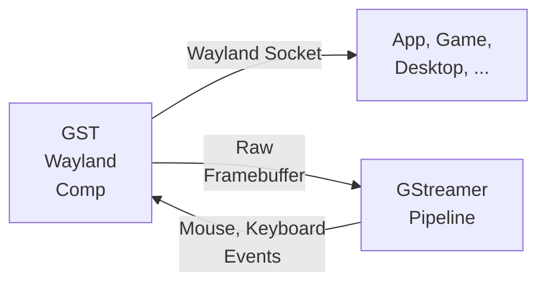

# gst-wayland-display

A micro Wayland compositor that can be used as a Gstreamer plugin. Based
on [smithay](https://github.com/Smithay/smithay)



## Install

see [cargo-c](https://github.com/lu-zero/cargo-c)

```bash
git clone https://github.com/games-on-whales/gst-wayland-display.git
cd gst-wayland-display
# Install cargo-c if you don't have it already
cargo install cargo-c
# Build and install the plugin, by default under 
cargo cinstall --prefix=/usr/local
```

## GStreamer plugin

By default it'll install the plugin in `/usr/local/lib/gstreamer-1.0/libgstwaylanddisplaysrc.so`.

You can check if the plugin is picked up by calling:

```bash
GST_PLUGIN_PATH=/usr/local/lib/gstreamer-1.0 gst-inspect-1.0 waylanddisplaysrc
```

Example pipeline:

```bash
GST_PLUGIN_PATH=/usr/local/lib/gstreamer-1.0 gst-launch-1.0 waylanddisplaysrc ! 'video/x-raw,width=1280,height=720,format=RGBx,framerate=60/1' !  autovideosink
```

If this starts you should have a wayland socket under `$XDG_RUNTIME_DIR`

```
ls $XDG_RUNTIME_DIR 
 wayland-1
 wayland-1.lock
```

You should then be able to start any wayland process and use that socket

```bash 
WAYLAND_DISPLAY=wayland-1 weston-simple-egl
```

## Zero copy pipeline support

This plugin supports outputting **DMA buffers** in order to achieve a proper **zero-copy pipeline**.  
It'll negotiate the proper caps with downstream elements using Gstreamer, you can read more about
it [in the official docs](https://gstreamer.freedesktop.org/documentation/additional/design/dmabuf.html?gi-language=c).

Example pipelines:

- AMD/Intel

```bash
gst-launch-1.0 waylanddisplaysrc ! 'video/x-raw(memory:DMABuf),width=1920,height=1080,framerate=60/1' ! vapostproc ! 'video/x-raw(memory:VAMemory), format=NV12' ! vah265enc ! vah265dec ! autovideosink
```

- Nvidia (or see below for an even better pipeline that uses CUDAMemory)

```bash
gst-launch-1.0 waylanddisplaysrc  ! 'video/x-raw(memory:DMABuf),width=1920,height=1080,framerate=60/1' ! glupload ! glcolorconvert ! 'video/x-raw(memory:GLMemory), format=NV12' ! nvh265enc ! nvh265dec ! autovideosink
```

### Support for Nvidia CUDAMemory

> [!IMPORTANT]
> This is gated behind the `cuda` feature flag. To enable it, you'll need to install `gst-cuda-1.0` and have access to
> `libcuda.so` at runtime.

This plugin supports outputting **CUDA buffers** for low-latency Nvidia pipelines. By not using `glupload` and
`glcolorconvert` we can not only be way more efficient, but it'll also allow us to re-use the GL context that we already
have in Smithay.

It can negotiate the CUDA Context with other elements in the pipeline, or it can be a source for other elements when
setting the property`cuda-device-id`. This is particularly useful when running in a multi-GPU environment as it gives
you full control over which GPU is used.

Example pipeline:

```bash 
gst-launch-1.0 waylanddisplaysrc cuda-device-id=0 ! 'video/x-raw(memory:CUDAMemory),width=1920,height=1080,framerate=60/1' ! nvh265enc ! nvh265dec ! autovideosink
```

In order to support this we leverage `gst-cuda-1.0` which adds a single build dependency to this project.
At runtime, you'll need to have access to `libcuda.so` but only to access and use `CUDAMemory`; you can still use
`DMABuf` when running this plugin on a platform that doesn't support it.

## Vulkan encode

Setting `vulkan=true` offers NV12 and P010 as `memory:VulkanImage`. The source harvests the
downstream encoder's `GstVulkanDevice` through a `gst.vulkan.device` context query and mints its
output images on that same device, so `vulkanh264enc` (NV12, 8-bit) and `vulkanh265enc` (P010,
Main-10) can view them with no copy. The RGBA to NV12/P010 conversion runs as a Vulkan compute
shader on the encoder's device.

```bash
gst-launch-1.0 waylanddisplaysrc vulkan=true render-node=/dev/dri/renderD128 \
  ! 'video/x-raw(memory:VulkanImage),format=NV12,width=1920,height=1080' \
  ! vulkanh264enc ! h264parse ! fakesink
```

> [!IMPORTANT]
> `vulkanh265enc` is not an upstream GStreamer element. It ships as `patches/vulkanh265enc.patch`
> and has to be applied to the GStreamer tree before building; see `patches/README.md`. The
> `docker/vulkan.Dockerfile` image applies it for you.

Pin `width` and `height` in the caps. Left open, the source fixates to 1x1 and negotiation settles
on whatever minimum the chosen encoder advertises, which is codec-specific: `vulkanh264enc` accepts
from 128x128 and `vulkanh265enc` from 130x128 on this driver. Both produce a valid stream, just not
at the size you probably wanted.

## HDR output

HDR is delivered as a 10-bit **P010** stream tagged BT.2100 (BT.2020 primaries, SMPTE 2084 PQ
transfer, limited range) plus static metadata, so a downstream `vulkanh265enc` (Main-10) emits the
matching VUI and mastering-display / content-light-level SEI. NV12 (8-bit) output is never tagged
HDR. **HDR requires the Vulkan encode path**: the RGBA → P010 conversion, the SDR→PQ tone-map and
the PQ passthrough all live in the Vulkan compute converter described above, so there is no HDR
over the VA/dmabuf or CUDA outputs.

There are two modes:

| Mode | How | What it does |
| --- | --- | --- |
| Static | `hdr=true` | Tags the P010 caps as BT.2100 PQ with the default (or overridden) static metadata and converts with the BT.2020 matrix. One-way; no client detection. The compositor content is SDR, so this is signalling plus an SDR→PQ tone-map, not new highlight detail. |
| Dynamic | `dynamic-hdr=true` | Full dynamic HDR: the compositor detects the client's HDR state and flips the P010 colorimetry mid-stream between BT.2100 PQ (HDR content) and BT.709 (SDR content), following the active surface. Set before starting the pipeline — the Wayland globals below are created at start. |

Both are **per-element properties, not environment variables**, which matters when one process
serves an HDR client and an SDR client at the same time: environment variables are process-global
and cannot differ per session, properties can.

| Property | Default | Purpose |
| --- | --- | --- |
| `hdr` | false | Static HDR tagging of the P010 caps (see the modes table). |
| `dynamic-hdr` | false | Dynamic HDR (see the modes table). Read once at start; set before the pipeline starts. |
| `mastering-display-info` | null | Override the mastering-display caps string; empty = default or, under `dynamic-hdr`, the game's metadata. |
| `content-light-level` | null | Override the content-light-level caps string; empty = default or, under `dynamic-hdr`, the game's metadata. |
| `sdr-reference-white` | 203 | SDR diffuse white in nits for the SDR→PQ tone-map (see the Vulkan conversion table). |

### Wayland protocols involved

Under `dynamic-hdr` the compositor advertises two color-management protocols and writes what it
learns from either into one shared per-surface HDR state:

- **`wp_color_management_v1`** (the standard staging protocol, spoken by sway and other
  desktop compositors). The full server side is implemented: the output is advertised as
  BT.2100 PQ so HDR clients enable their HDR path, and clients attach an image description
  (transfer function, primaries, mastering luminance, MaxCLL/MaxFALL) to their surface.
- **`frog_color_management_v1`** (gamescope/Steam Deck protocol, vendored XML). gamescope
  does **not** speak `wp_color_management_v1`; it signals HDR by submitting 10-bit
  already-PQ BT.2020 buffers and, through frog, the game's real mastering metadata.

HDR detection is dual-source, whichever fires first:

1. the active surface declared PQ through either protocol, or
2. the surface's last committed buffer is a 10-bit packed RGB fourcc (`XB30`/`AB30`/
   `XR30`/`AR30`) — gamescope's already-PQ output. This heuristic is what actually detects
   a gamescope HDR game.

### How it works end to end

1. **Detection**: on every commit the compositor records the surface's HDR state; a candidate
   HDR↔SDR flip must hold for 600 ms (debounce) before it commits, so a stray 8-bit UI frame
   between 10-bit game frames cannot blank the TV with a mode switch.
2. **Signalling**: on a committed flip the compositor sends the new state (plus the game's real
   mastering/CLL metadata when it provided any) to the source, which (a) posts a
   `wolf-hdr-state` application message on the GStreamer bus and (b) marks the src pad for
   renegotiation.
3. **Renegotiation**: the source re-runs caps negotiation and pushes new CAPS: BT.2100 PQ +
   mastering-display-info + content-light-level when HDR, plain BT.709 when SDR. The encoder
   re-emits its VUI and HDR SEI at the next IDR. The converter is *not* rebuilt for a
   colorimetry-only change — both pipelines are pre-built and picked per frame.
4. **Conversion**: the Vulkan converter picks the shader per frame. SDR 8-bit content takes
   the SDR→PQ tone-map (sRGB EOTF → linear BT.709 → BT.2020 gamut → reference white at
   `sdr-reference-white` nits → PQ OETF → BT.2020 Y'CbCr). A frame that came from an
   already-PQ 10-bit client buffer takes the PQ-passthrough shader (Y'CbCr matrix only), so
   it is not double-encoded. Under `dynamic-hdr` the render target itself is fp16
   (`Abgr16161616f`) and the compositor additionally advertises fp16/10-bit dmabuf formats to
   clients, so genuine >1.0 highlights can reach the encoder.

The static metadata defaults (BT.2020 primaries, 1000-nit master, 1000:400 CLL) can be overridden
per element with the `mastering-display-info` and `content-light-level` properties (gst caps
string format); under `dynamic-hdr` the game's own values take precedence unless overridden.

## Environment variables

These are read once at startup. Everything here is off or neutral when unset, so the default
behaviour is what you get without setting any of them. The diagnostic ones exist for tracking
driver bugs and are not intended for normal use. Configuration that affects streaming is
property-based (see the tables above and the [HDR section](#hdr-output)).

HDR:

| Variable | Default | Effect |
| --- | --- | --- |
| `WOLF_HDR_PEAK_NITS` | `1000` | Display peak luminance advertised to the client through frog, in nits. Match it to the target TV. Max-full-frame is derived as 40% of it. |

Diagnostics:

| Variable | Default | Effect |
| --- | --- | --- |
| `WOLF_VULKAN_DUMP` | unset | Path to write one raw NV12 frame of the converter's output, taken before the encode-src copy. Distinguishes conversion corruption from downstream corruption. |
| `WOLF_VULKAN_DUMP_FRAME` | `20` | Which frame `WOLF_VULKAN_DUMP` captures. Raise it to let a client connect and paint first. |
| `WOLF_HDR_SPIKE` | unset | Draw synthetic above-1.0 brightness bars across the top of the output and read the framebuffer back once, to check whether GLES preserved or clamped them. Changes what is rendered, so do not leave it set. |

## Run without a GPU

If you don't have a GPU, you can still run this plugin without it; just use the option `render_node=software` to enable it. Example pipeline:
```bash 
gst-launch-1.0 waylanddisplaysrc render_node=software ! 'video/x-raw,width=1280,height=720,format=RGBx,framerate=60/1' !  videoconvert ! autovideosink
```

## Mouse and Keyboard

To pass mouse and keyboard events to the Wayland compositor you have two options: 
 - Pass two valid input devices to the plugin using the `keyboard` or `mouse` options (ex: `waylanddisplaysrc keyboard=/dev/input/event20 mouse=/dev/input/event21`)
 - Send the inputs as raw events to the Gstreamer pipeline

For example, here's [how Wolf sends the mouse movements](https://github.com/games-on-whales/wolf/blob/b4c4571b061cd243a4606bd16969c235767d6ec2/src/core/src/platforms/linux/virtual-display/gst-wayland-display.cpp#L45-L53) to gst-wayland-comp:
```c++
  auto msg = gst_structure_new("MouseMoveRelative",
                                "pointer_x", G_TYPE_DOUBLE, static_cast<double>(delta_x),
                                "pointer_y", G_TYPE_DOUBLE, static_cast<double>(delta_y),
                                NULL);
  gstreamer::send_message(w_state->wayland_plugin.get(), msg);
```

Mouse, Keyboard and Touch events are supported by the plugin. 


## C Bindings

CmakeLists.txt

```cmake
pkg_check_modules(libgstwaylanddisplay REQUIRED IMPORTED_TARGET libgstwaylanddisplay)
target_link_libraries(<YOUR_PROJECT_HERE> PUBLIC PkgConfig::libgstwaylanddisplay)
```

Include in your code:

```c
#include <libgstwaylanddisplay/libgstwaylanddisplay.h>
```

Example usage:

```c++
auto w_state = display_init("/dev/dri/renderD128"); // Pass a render node
        
display_add_input_device(w_state, "/dev/input/event20"); // Mouse
display_add_input_device(w_state, "/dev/input/event21"); // Keyboard

// Setting video as 1920x1080@60
auto video_info = gst_caps_new_simple("video/x-raw",
                                  "width", G_TYPE_INT, 1920,
                                  "height", G_TYPE_INT, 1080,
                                  "framerate", GST_TYPE_FRACTION, 60, 1,
                                  "format", G_TYPE_STRING, "RGBx",
                                  NULL);
display_set_video_info(w_state, video_info);

// Get a list of the devices needed, ex: ["/dev/dri/renderD128", "/dev/dri/card0"]
auto n_devices = display_get_devices_len(w_state);
const char *devs[n_devices];
display_get_devices(w_state, devs, n_devices);

// Get a list of the env vars needed, notably the wayland socket
// ex: ["WAYLAND_DISPLAY=wayland-1"]
auto n_envs = display_get_envvars_len(w_state);
const char *envs[n_envs];
display_get_envvars(w_state, envs, n_envs);

// Example of polling for new video data
GstBuffer * v_buffer;
while(true){
  v_buffer = display_get_frame(w_state);
  // TODO: do something with the video data
}

display_finish(w_state); // Cleanup
```
### Vulkan conversion configuration

Use explicit dimensions when connecting a Vulkan encoder; NVENC rejects the
small test dimensions selected by an unconstrained pipeline. For example:

```sh
gst-launch-1.0 waylanddisplaysrc render-node=/dev/dri/renderD128 vulkan=true \
  ring-depth=4 ! 'video/x-raw(memory:VulkanImage),width=1280,height=720,framerate=60/1' \
  ! vulkanh264enc ! fakesink
```

Set these properties before starting the pipeline. They belong to each source,
so independent sessions may use different values:

| Property | Default | Purpose |
| --- | --- | --- |
| `ring-depth` | 4 | Allocated conversion slots, 1–4. Keep 4 for streaming unless you have verified a smaller ring with your consumers. At 1 slot the ring cannot rotate past a slot that is still referenced downstream, so every frame waits the reuse gate's full 1s timeout, drops, and re-emits the previous output (0.45 fps measured on an RTX 5090 with `enable-last-sample=false` on the sink; leaving `enable-last-sample` on pins the newest buffer too and makes it worse). Use `1` only to inspect per-slot image addresses, not to stream. |
| `linear-encode-src` | false | Prefer LINEAR Vulkan encode images, with OPTIMAL allocation fallback. Works around a radv GFX12/RDNA4 bug that corrupts a LINEAR-to-tiled `vkCmdCopyImage`. |
| `sdr-reference-white` | 203 | SDR white level in nits for SDR → PQ conversion, 1–10000. |
| `vulkan-profile` | format-dependent | H.264 `high` by default for NV12; set `main` or `constrained-baseline` etc. to match the encoder. P010 requires `main-10` (H.265). |

A directly connected H.264 encoder's fixed output profile is discovered through
simple filters and queues. Raw caps cannot express an encoder's codec/profile
across interpipe. Configure `vulkan-profile` consistently with that consumer; an incompatible profile can
force a copy or be rejected by the driver. The source creates raw frames, and
encoding remains downstream so lobbies can fan out to multiple consumers.

LINEAR Vulkan images carry their real plane offsets and strides in `VideoMeta`.
OPTIMAL-tiled Vulkan images have no portable byte layout: their `VideoMeta`
describes logical planes only and **must not be used for CPU row addressing**.
Consumers must use the VkImage and a Vulkan-aware conversion/download element.
The converter waits for GPU completion on the Vulkan encode path before exposing
an image, paying that synchronization latency per frame; VA dmabuf output uses
implicit synchronization where the driver supports it.

The plugin does not change process environment variables when loaded. If a host
hits a lavapipe/Mesa LLVM initialization collision, configure
`VK_LOADER_DRIVERS_DISABLE='*lvp_icd*'` in the launching process before it starts.
Software Vulkan remains available to embedding applications by default.

HDR — including the `dynamic-hdr`, `mastering-display-info` and `content-light-level`
properties and the Wayland protocols behind them — has its own section above; see
[HDR output](#hdr-output). Diagnostic knobs `WOLF_HDR_SPIKE`, `WOLF_VULKAN_DUMP`, and
`WOLF_VULKAN_DUMP_FRAME` remain environment variables (documented below). Regenerate
committed SPIR-V with `bash ci/shaders.sh --update`; CI recompiles and compares every
shader with its GLSL source.

The current unified build requires **GStreamer Vulkan >= 1.28** and Vulkan loader
headers, even when only the CUDA/VA path is used. The bindings' Vulkan `v1_28`
feature and header-compiled bridge enforce this; older distro GStreamer needs a
newer installation prefix. See [CONTRIBUTING.md](CONTRIBUTING.md).
